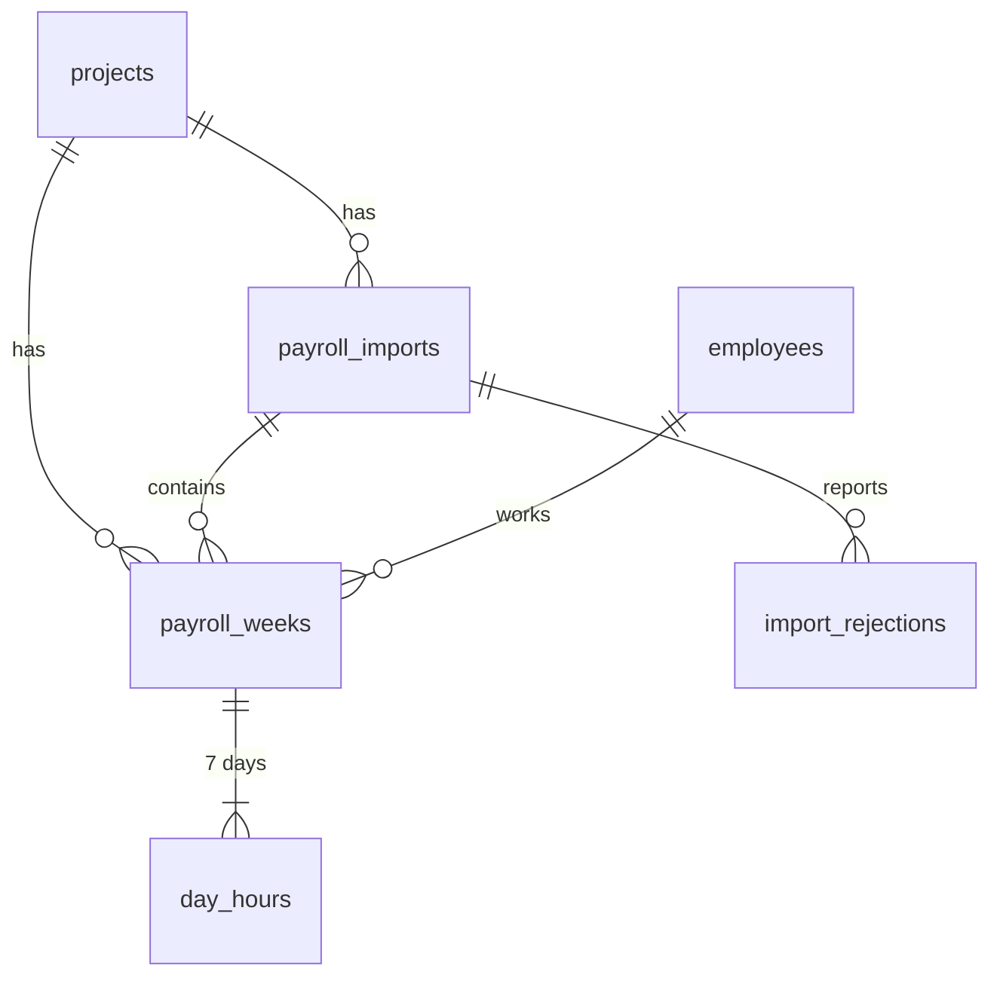

# MoneyBall

A dashboard for reviewing weekly payroll for [Prevailing Wages and Apprenticeship](https://www.irs.gov/credits-deductions/prevailing-wage-and-apprenticeship-requirements) compliance.
It shows summary statistics, per-employee statistics and likely data-entry errors.

## Requirements

- Node.js 26
- pnpm (run `corepack enable` to use the version pinned in `package.json`)

No database server is needed: the database is a local SQLite file.

## Getting started

```bash
pnpm install
cp .env.example .env.local   # DATABASE_URL=file:local.db
pnpm db:migrate              # create the SQLite database and its tables
pnpm db:seed                 # import data/payroll_data.csv
pnpm dev
```

Open http://localhost:3000/

To skip the database, run just `pnpm install` and `pnpm dev`. Without `.env.local`, the dashboard reads `data/payroll_data.csv` directly.

Run `pnpm test --run` for the unit tests. To reset the database, delete `local.db` and run `pnpm db:migrate && pnpm db:seed` again.

Pre-commit git hooks run Prettier and ESLint on staged files.

## Project structure

```
data/payroll_data.csv          Source data
src/lib/payroll/               Reusable logic for detecting anomalies, payroll stats
  types.ts                     Source-agnostic data model (DTO), can be read from CSV, DB, ect.
  stats.ts                     Summary and per-employee statistics
  anomalies.ts                 Anomaly rules and thresholds
src/app/                       The Next.js application that handles routing and server/client side rendered components.
```

The UI only depends on `PayrollRecord` and `getPayrollData()`.
This was implemented as a way to keep the logic/frontend decoupled from the source of the data (CSV or DB table)

## Database

We use SQLite as the DB engine to keep things simple for this assignment and to keep options open (e.g., upgrade to postgres later, or deploy to Cloudflare D1).
The DB is kept in sync with the drizzle package, which acts as an ORM and the way we migrate the database for any 'future' changes.



| Table               | Holds                                                                      |
| ------------------- | -------------------------------------------------------------------------- |
| `projects`          | A construction project (URL slug, name)                                    |
| `employees`         | A worker, independent of any project                                       |
| `payroll_imports`   | An uploaded of payrol records, in if expanded, we'd use an s3 like storage |
| `import_rejections` | Rows from an import that couldn't be parsed, need to be kept for auditing  |
| `payroll_weeks`     | One employee's pay line for one week                                       |
| `day_hours`         | Standard and overtime hours for each day of that week                      |

Schema: `src/db/schema.ts`. Migrations: `drizzle/`.

```bash
cp .env.example .env.local   # DATABASE_URL=file:local.db
pnpm db:migrate              # create/update the local database
pnpm db:seed                 # import data/payroll_data.csv (safe to re-run)
pnpm db:generate             # after editing the schema: write a new migration
```

## Features

### Summary statistics

- Unique employees (counted by employee ID) and apprentice count
- Pay period and number of weeks
- Total, standard and overtime hours
- Apprentice share of hours
- Total spend, split into wages and benefits
- Average standard, overtime and benefits rates, weighted by hours

### Employee statistics

- Weeks worked
- Hours per day (min / avg / max), counting only days worked
- Total spend
- Number of flagged weeks
- Name variants recorded under the same ID
- Rates (standard, overtime, benefits; min / avg / max), in a modal opened from the row's menu

Both tables support search, dropdown filters, column sorting and pagination (10/25/50/100 rows per page).

### Anomaly detection

Each anomaly has a severity and keeps a reference to its source record. Every threshold is configurable in `DEFAULT_THRESHOLDS`.

| Check                    | Severity   | Rule                                                                                        |
| ------------------------ | ---------- | ------------------------------------------------------------------------------------------- |
| Standard rate deviation  | High       | More than 20% from the employee's own median rate (needs 3+ weeks of history)               |
| Benefits rate deviation  | Medium     | More than 20% from the employee's own median rate                                           |
| Overtime rate mismatch   | Medium     | Overtime rate is not 1.5x the standard rate                                                 |
| Long day / short day     | High / Low | Over 14 h / under 3 h on a worked day                                                       |
| Long week / short week   | High / Low | Over 60 h / under 16 h                                                                      |
| unpaid overtime          | Medium     | More than 40 standard hours in a week (likely unpaid overtime)                              |
| Apprentice ratio         | Medium     | More apprentices than journeyworkers of the same trade on a day (default 1:1, configurable) |
| Rate vs trade peers      | Medium     | Usual rate more than 25% from the median for the same trade and level (groups of 3+)        |
| Name mismatch            | Medium     | Name differs from the most common name for that ID                                          |
| Duplicate week           | High       | More than one row for the same employee and week                                            |
| Week ending not Saturday | Medium     | `week_ending` falls on another weekday                                                      |

Rows with invalid values (a non-numeric rate, an impossible date, an unknown level) are rejected and reported. All other rows are kept and flagged, so no data is silently dropped.

### Future work

Area that I would have gotten to with a little more time.

- Store detected anomalies: The data model currently does not store detected anomalies, so they have to be recomputed on the fly. This is OK for a small number of payroll weeks and employees, but in order to be scalable, we need to store anomalies.
- Upload with import review: Let a project manager upload a CSV and see rejected rows and name changes for an existing payroll ID (typo vs. a different person) before the data is saved, instead of finding them later as anomalies.
- Use wage and apprenticeship rules: Compare pay to a wage determination for a project, and use each trade's real apprentice ratio instead of the 1:1 default.
- Deploy. Host the app with a managed SQLite database (Cloudflare D1 or Turso) and add sign-in so each user sees only their own projects.
